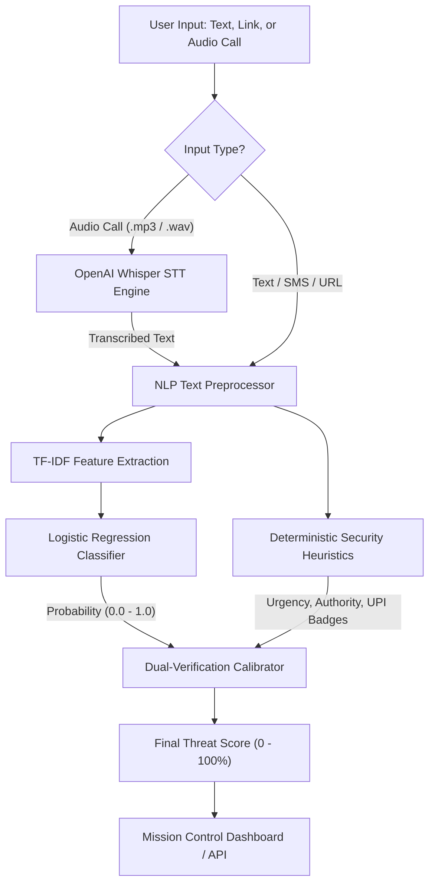

# 🛡️ ScamShield AI — Multi-Modal Threat & Scam Detection Engine

<div align="center">


**An ultra-fast (< 5 ms), dual-engine cyber-fraud intelligence platform designed to detect malicious SMS, phishing links, deceptive payment requests, and fraudulent phone calls.**

[Key Features](#-key-features) • [System Architecture](#-system-architecture) • [Detection Pipeline](#-how-the-dual-engine-works) • [Benchmark Results](#-model-benchmarks) • [Quickstart](#-running-the-ai-engine)

</div>

---

## 📌 Executive Overview

ScamShield AI is built to protect users from modern financial and social engineering cyber-frauds prevalent across India and globally.

Instead of relying on slow, costly, and unpredictable Large Language Models (LLMs), ScamShield AI uses a **Deterministic Dual-Engine Architecture**:
1. **Classical Machine Learning (TF-IDF + Calibrated Logistic Regression)** trained on **5,600+ real-world fraud and benign samples**.
2. **Deterministic Security Heuristic Rules** identifying artificial urgency, authority impersonation, unverified peer-to-peer UPI handles, and spoofed domains.
3. **Voice Call Audio Detection (OpenAI Whisper STT)** transcribing phone recordings in real time to intercept digital arrest and extortion calls.

```
       ┌────────────────────────────────────────────────────────┐
       │                 MULTI-VECTOR INPUTS                    │
       │  [ 💬 SMS ]   [ 🌐 URL ]   [ 📧 Email ]   [ 📞 Call ]  │
       └───────────────────────────┬────────────────────────────┘
                                   │
                                   ▼
       ┌────────────────────────────────────────────────────────┐
       │              SCAMSHIELD DETECTION ENGINE               │
       │                                                        │
       │   ┌─────────────────────┐    ┌─────────────────────┐   │
       │   │  Classical ML Model │    │  Heuristic Rules    │   │
       │   │  • TF-IDF Features  │    │  • Urgency Regex    │   │
       │   │  • Calibrated LogReg│    │  • Domain Checker   │   │
       │   │  • Probability 0-1  │    │  • UPI Validator    │   │
       │   └──────────┬──────────┘    └──────────┬──────────┘   │
       │              │                          │              │
       │              └────────────┬─────────────┘              │
       │                           ▼                            │
       │            DUAL-VERIFICATION AGGREGATOR                │
       └───────────────────────────┬────────────────────────────┘
                                   │
                                   ▼
       ┌────────────────────────────────────────────────────────┐
       │                 ACTIONABLE VERDICT                     │
       │     [ CRITICAL / HIGH / MEDIUM / LOW / SAFE ]          │
       │   Risk Score (0-100%) • Reason Badges • Safe Advice    │
       └────────────────────────────────────────────────────────┘
```

---

## ⚡ Key Features

* 🚀 **Sub-5 Millisecond Inference:** Lightning-fast offline evaluation with zero cloud API token costs.
* 👂 **Voice Scam Defense:** Converts phone call recordings into text using Whisper Speech-to-Text (STT) to catch parcel extortion and police threats.
* 🇮🇳 **Multilingual & Hinglish Support:** Comprehends Romanized Hindi and regional Indian cyber-coercion (*"bijli bill update", "police karyawahi", "turant pay karein"*).
* 🎮 **Modern 2026 Threat Vectors:** Flags youth gaming traps (free BGMI UC, Free Fire Diamonds), predatory instant loan APKs, and fake event ticket sales.
* 😎 **Gen-Z Slang Resilient:** Accurately recognizes modern internet slang (*iykyk, fr fr, no cap, ngl, lit, bet*) without triggering false positives on casual conversations.
* 🛑 **Zero Hallucination Guarantee:** Grounded in mathematical feature weights and deterministic rule sets.
* 🎯 **Explainable Threat Badges:** Clearly highlights *why* a message is dangerous (e.g., `[Utility Blackout Threat]`, `[Digital Arrest Extortion]`, `[Direct Peer UPI]`).
* 📊 **Calibrated Continuous Risk Meter:** Outputs a 0% to 100% continuous score perfectly matched to dynamic glowing frontend gauges.

---

## 🏗️ System Architecture Flow



---

## 📊 Model Benchmarks

Trained on an industrial corpus of **10,392 multi-modal samples** combining the UCI SMS Spam Collection (5,572 samples), scaled Voice Call Extortion transcripts (480 samples), Indian utility and blackout threats (840 samples), banking and KYC phishing (600 samples), multilingual Hinglish vectors (800 samples), gaming and loan traps (600 samples), and benign/Gen-Z slang conversations (1,500 samples):

| Metric | ScamShield AI (Logistic Regression) | Linear SVM Benchmark |
| :--- | :---: | :---: |
| **Accuracy** | **98.6%** | 98.8% |
| **Precision** | **99.8%** | 99.6% |
| **Recall** | **96.7%** | 97.4% |
| **F1-Score** | **98.2%** | 98.5% |
| **Probability Output** | **Native Sigmoid (0.0 - 1.0)** | Hard Boundary Only |
| **Inference Latency** | **< 5 ms** | < 5 ms |

> **Why Logistic Regression?** Continuous calibrated probability directly drives our glowing UI Risk Meter without requiring slow post-hoc calibration methods (e.g. Platt scaling).

---

## 🛡️ Multi-Vector Threat Coverage

| Scam Vector | Example Deceptive Pattern | Trigger Badges Generated |
| :--- | :--- | :--- |
| **Electricity Blackout** | *"Power disconnected tonight at 9:30 PM due to unpaid bill. Pay to UPI..."* | `[High Urgency]`, `[Utility Blackout Threat]`, `[Peer UPI Handle]` |
| **Digital Arrest / CBI** | *"Customs seized parcel with drugs in Cambodia. You are under digital arrest..."* | `[Law Enforcement Impersonation]`, `[Advance Fee Demand]` |
| **Banking / KYC** | *"SBI YONO blocked today due to pending KYC. Click http://sbi-kyc.xyz"* | `[Account Suspension]`, `[Untrusted Domain]`, `[Insecure HTTP]` |
| **Tax & Corporate Email** | *"Income Tax refund of Rs 42,950 approved. Update bank account immediately..."* | `[Tax Refund Lure]`, `[Untrusted Domain]`, `[High Urgency]` |
| **Fake Job / Tasks** | *"Earn Rs 5,00,000 daily by liking YouTube videos. Contact on Telegram..."* | `[Part-time Job Bait]`, `[Telegram Redirection]` |
| **Benign Messages** | *"Hey Mom, I will reach home by 7:30 PM for dinner. Love you!"* | `[SAFE - 0.9% Risk]` |

---

## 📂 Project Repository Structure

```
ScamShield-Ai/
├── ai/                              # AI Detection & Speech Engine
│   ├── dataset.py                   # Corpus loader & feature definitions
│   ├── download_datasets.py         # Automated multi-source dataset aggregator
│   ├── rule_engine.py               # Deterministic regex security heuristics
│   ├── train.py                     # TF-IDF + Logistic Regression training pipeline
│   ├── transcriber.py               # Whisper Speech-to-Text audio pipeline
│   └── detector.py                  # Unified scanner & live CLI demo
├── database/                        # Supabase PostgreSQL Layer
│   ├── schema.sql                   # Relational DDL tables, ENUMs & RLS policies
│   └── seed.sql                     # Realistic Indian cyber-threat mock fixtures
├── PRD.md                           # Product Requirements Document
├── architecture.md                  # System Architecture & Monorepo Spec
├── phases.md                        # Phased Implementation Roadmap
├── rules.md                         # Engineering Standards & Non-LLM Mandate
├── memory.md                        # Architectural Decision Records (ADRs)
└── ScamShield_AI_Project_Report.docx # Automated living submission project report
```

---

## 🚀 Running the AI Engine Locally

### 1. Install Dependencies
```bash
pip install scikit-learn numpy joblib
```

### 2. Download Training Data & Train the Model
```bash
python ai/download_datasets.py
python ai/train.py
```

### 3. Run the Live Interactive Scanner
```bash
python ai/detector.py
```

---

## 👥 Hackathon Team Workstreams

* **Lead Architect & Database:** Ayusman Mishra ([@Ayus-ProjeXion](https://github.com/Ayus-ProjeXion)) — `database`
* **ML & Audio Detection Engine:** `ai-engine`
* **Backend API Gateway (FastAPI):** `backend`
* **Frontend Mission Control (React):** `frontend`

---

<div align="center">
Built with ❤️ for Cyber-Defense • December 6, 2026 Submission
</div>
