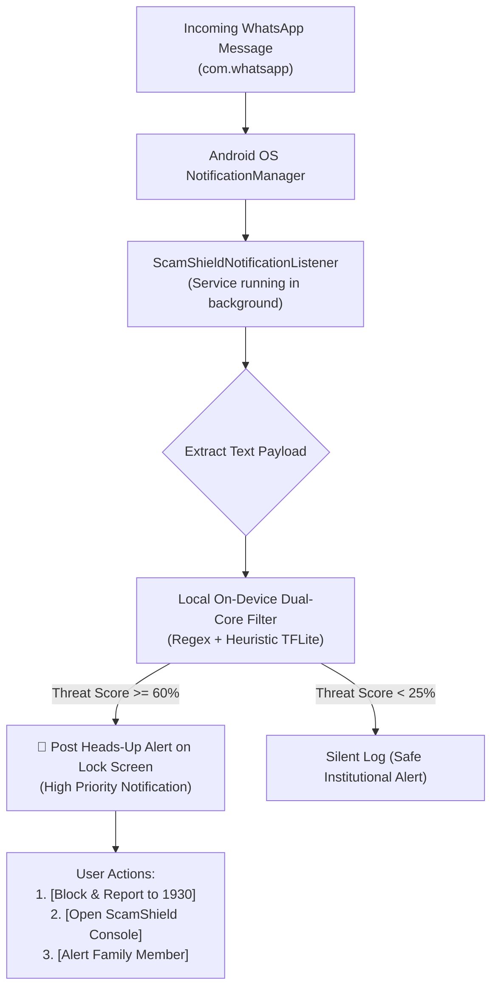

# 📱 ScamShield AI — Android Native Companion Architecture

## 1. Problem & Mobile Operating System Security Boundaries

### Why Web Apps Cannot Silently Read Incoming WhatsApp or SMS:
- Modern mobile operating systems (Android & iOS) enforce strict **process sandboxing**.
- A web application running inside Chrome or Safari is isolated from the host operating system. The browser sandbox prohibits websites from eavesdropping on incoming background SMS or third-party messaging apps like WhatsApp.
- If web browsers allowed this, malicious websites could secretly steal 2-Factor Authentication OTPs and private bank alerts from citizens.

### How Native Production Products (Truecaller, NotiX, Microsoft SMS Organizer) Solve This:
To deliver instant, automated fraud alerts the millisecond an SMS or WhatsApp arrives, the architecture requires an **Android Native Companion Service**:
1. **`NotificationListenerService` (`android.permission.BIND_NOTIFICATION_LISTENER_SERVICE`)**:
   - The user grants explicit one-time permission in Android Settings -> Special App Access -> Notification Access.
   - Android securely passes incoming `StatusBarNotification` events from `com.whatsapp` and `com.google.android.apps.messaging` to ScamShield.
2. **`SMS_RECEIVED` BroadcastReceiver (`android.permission.RECEIVE_SMS`)**:
   - Intercepts incoming SMS PDUs before or as they land in the inbox.
3. **On-Device Threat Evaluation (< 2ms)**:
   - Evaluates the notification text against local fraud signatures (regex & lightweight TensorFlow Lite).
   - If risk > 60%, immediately posts a high-priority heads-up alert:
     `🚨 SCAM INTERCEPTED (96%): Electricity KYC Fraud` with 1-click actions:
     - `[Block Sender]`
     - `[Dial 1930 Helpline]`
     - `[View in ScamShield Web Console]`

---

## 2. Component File Structure

```
android-companion/
├── AndroidManifest.xml                  # OS permissions & service declarations
├── ScamShieldNotificationListener.kt    # Intercepts WhatsApp & SMS StatusBarNotifications
├── SmsBroadcastReceiver.kt              # Low-latency PDU SMS receiver
└── README.md                            # Architecture & deployment blueprint
```

---

## 3. Data Flow Diagram


